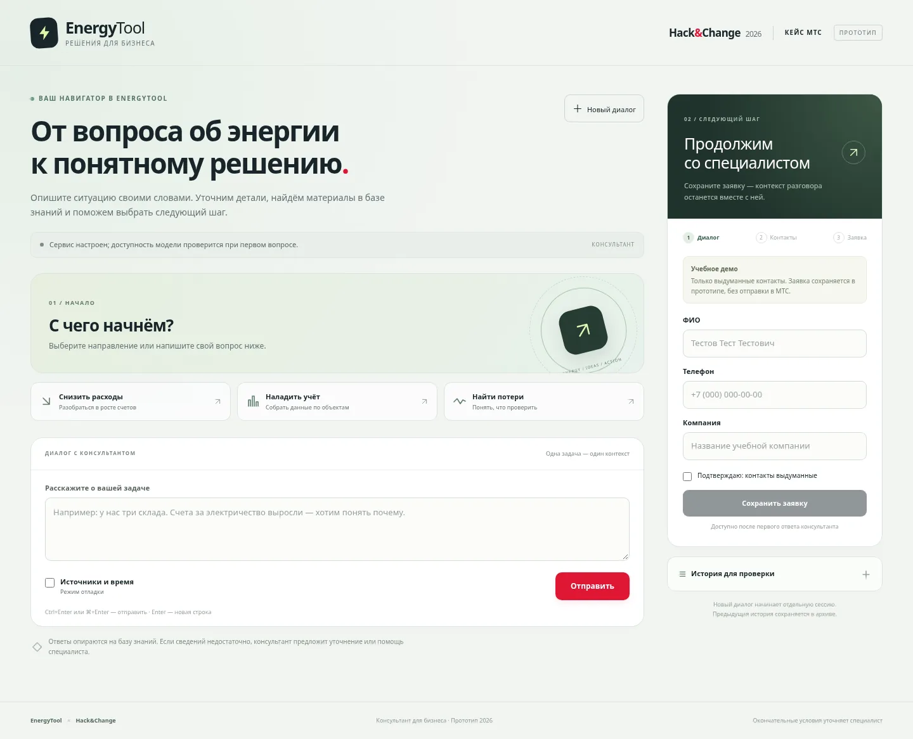

# EnergyTool: интерфейс и проверка браузером

База проверки: main `12892bf8ba7ee21502b13ece135767ea33d47bc1` (включая readiness из PR #13).
Автор: Codex Глеба / @popt-web. Задача #2, интерфейс передан Глебу в R-005 и AGENTS.md.
Изменения приложения ограничены `static/`; HTTP-контракт сохранён.

## Дизайн

Светлая рабочая область, тёмный зелёный блок заявки, красные акценты действия,
энергетическая графика и маркировка Hack&Change 2026 / кейс МТС / прототип.
Знакомство с продуктом ведёт к вопросу, затем к добровольной заявке.
Фиктивных показателей экономии и обещаний совместимости в интерфейсе нет.
Весь визуал — CSS и встроенный SVG; нет внешних шрифтов, CDN, фреймворка или сборщика.



[Полная мобильная версия](ui/mobile.webp)

## Изменения поведения

- Ошибка API не рисуется как ответ консультанта. Вопрос возвращается в поле для повтора.
- Отдельные сообщения для сетевой ошибки и ответа сервера в некорректном формате.
- Заявка доступна после успешного ответа; после сохранения контакты защищены от редактирования.
- Новый диалог очищает форму, резюме, ошибки, отладку, ключ архива, список и детали;
  ответ старого запроса архива после сброса игнорируется.
- Источники и время доступны через переключатель отладки.
- Readiness использует необязательные поля knowledge_base_ready/model_configured/model,
  поддерживает прежний ответ health. provider_verified обозначает предыдущий успешный
  вызов в процессе, не гарантирует качество или следующий ответ.
- Ctrl/Cmd+Enter отправляет, Enter переносит строку. При первоначальной загрузке
  поле не получает фокус, чтобы не вызывать клавиатуру и прокрутку на телефоне.
- Подписи полей, live regions, клавиатурный focus, skip link, reduced motion.
  Полный аудит WCAG и проверка экранным диктором не выполнялись.

## Выполненная проверка

`python -m unittest discover -s tests -v`: **54/54 OK**, 5.146 s,
Python 3.12, зависимости из существующего venv с requirements-dev.
Набор взят из указанного main; приложение проверялось с новой static-версией.
Последующая правка SVG и начального фокуса проверена браузером.

Playwright + системный Chromium: **1440×1000, 768×1024, 390×844**:

- 503, обрыв соединения и HTML вместо JSON: понятная ошибка, восстановление вопроса,
  отсутствие фиктивного ответа;
- успешный ответ, отладка с 17 мс и synthetic.md;
- строки с HTML/script показываются текстом, не исполняются;
- сохранение синтетической заявки, блокировка повторного редактирования;
- новый диалог полностью сбрасывает данные формы, отладку и ключ архива;
- пять вариантов health: прежняя схема, нет базы, нет модели, настроен без вызова,
  ранее получен ответ;
- нет ошибок JavaScript и горизонтального переполнения; первоначальная страница
  не прокручивается к форме автоматически.

Скриншоты и браузерные ответы синтетические. Это проверка интерфейса и контракта,
не качества живой модели. Платных API-вызовов здесь нет. Живой бесплатный прогон
после PR выполняет интеграция (C-011), отдельно от этой проверки.

## Повторение браузерной проверки

Нужны Python, пакет `playwright` и Chromium по пути `/usr/bin/chromium`.
При другой установке измените `executable_path` в скрипте.
Из корня репозитория в первом терминале:

```sh
python -m http.server 8765 --bind 127.0.0.1
```

Во втором:

```sh
python docs/reviews/gleb-ui-browser-check.py
```

Скрипт подменяет только `/api/**` синтетическими ответами. Снимки записывает рядом
с собой; не добавляйте временные PNG в git. Настоящие ключи и база не требуются.
